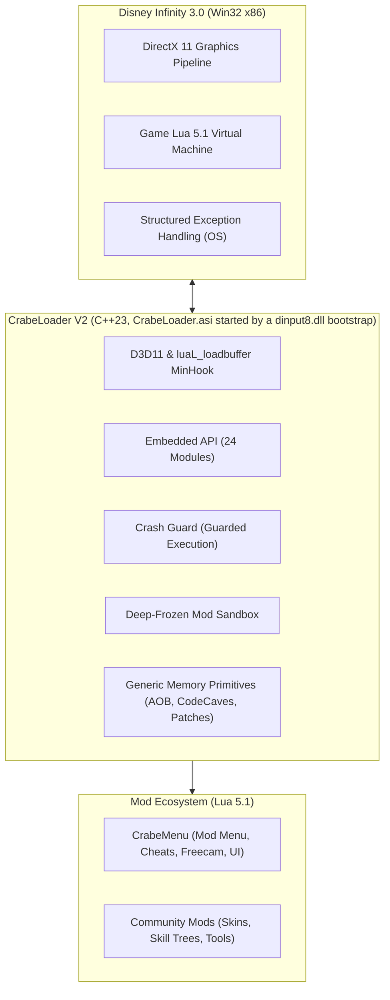

# CrabeLoader V2 — Documentation & Modding Guides

Welcome to the official **CrabeLoader V2** documentation suite. 

This directory contains in-depth, structured guides in plain English covering every aspect of extending and modding **Disney Infinity 3.0: Gold Edition (PC)**.

---

## 📚 Guides in this Section

| Guide | Description | Target Audience |
| :--- | :--- | :--- |
| **[Mod Development Guide](mods.md)** | Learn how to build standalone and folder-based Lua mods, hook lifecycle events (`onInit`, `onUpdate`, `onDraw`, `onShutdown`), design Dear ImGui interfaces, apply memory patches, and leverage live hot-reloading (`F4`). | Beginner to Advanced Modders |
| **[Skill Tree Modding Guide](skilltrees.md)** | Comprehensive breakdown of how character abilities and progression trees are loaded. Learn how to write chunk patches (`.patch`) and full source overrides (`.lua`) to customize combat stats, reduce costs, or build brand-new skill branches. | Intermediate Modders |
| **[Character & Figurine Guide](characters.md)** | Master the game's figurine resolution pipeline (`SKU -> AvatarData -> Name -> ActorList -> DNA`). Learn how to expose unreleased figures (Mace Windu, Thanos) and register custom character variants using `Crabe.VirtualReader`. | All Modders & Roster Creators |
| **[crabe-cli Reference](cli.md)** | Scaffold a new mod, validate a manifest, run the real dependency resolver, and catch Lua API typos -- all offline, without launching the game. | All Modders & CI Pipelines |
| **[Loose Texture Overrides & VFS](vfs_textures.md)** | Intercept asset and texture loading via the Virtual File System (VFS), override textures with loose `.tbody` files, and hot-reload in real-time (`F4`). | Texture Artists & Modders |
| **[Native `.asi` Plugins](asi_plugins.md)** | Load native 32-bit `.asi` plugins from the game folder, `scripts/`, `plugins/` or a mod's folder, before the game's own code runs. Turn them off in `crabe.toml`, read what loaded from Lua with `Crabe.Plugins`, and write your own with the C plugin API (log, hooks, Lua, values shared with mods). | Native Plugin Authors & Players |
| **[Update Check & CrabeInstaller](updates_and_installer.md)** | How the launch-time update prompt works and how to turn it off, plus the one-click installer that adds `dinput8.dll` (a small bootstrap) and `CrabeLoader.asi` (the loader), and the rule that it never overwrites a game file or a `dinput8.dll` or `CrabeLoader.asi` that is not CrabeLoader's. | Players & Maintainers |
| **[Disney Infinity Base & Figure Registry](portal.md)** | Use a physical Disney Infinity base (Xbox One, Xbox 360, PS3/PS4/Wii/Wii U/PC) from Lua with `Crabe.Portal`, and add figures to the engine's own registry with `Crabe.Gateway` so each figure keeps its own progression. | Modders & Hardware Tinkerers |
| **[Key Bindings](key_bindings.md)** | In-game key and controller rebinding: rebind the game's own keys, mouse and controller buttons from Options > Controls, built natively into CrabeLoader and saved to `Crabe/keybinds.json`. | Players & Modders |

---

## 🏛️ Architectural Foundations (CrabeLoader V2)

CrabeLoader V2 is built around a decoupled **SOLID architecture**:

### Core Tenets of V2
1. **Zero Gameplay in C++:** `CrabeLoader` contains no hardcoded cheats, speedhacks, or menus. It is purely an engine platform.
2. **Crash-Resilient:** All mod hooks and UI rendering run inside SEH-guarded wrappers. A bug in a mod will log an error without crashing the game to desktop.
3. **Deep Sandbox:** Each mod runs in an isolated environment. Core tables (`Game`, `table`, `string`, `math`, `_G`) are protected by read-only proxy metatables.
4. **Embedded API:** All standard API modules are compiled directly into `CrabeLoader.asi`. No loose `api/` scripts are required.
5. **Instant Iteration:** Press **F4** in-game to hot-reload all mods in under 50 milliseconds without restarting the game.

---

## 🔗 Additional References

* **[Native Function Database](../nativedb.md):** Alphabetical encyclopedia of discovered C++ engine functions exposed to Lua.
* **[Lua API Type Definitions (`crabe_api.def.lua`)](../crabe_api.def.lua):** EmmyLua type annotations for VS Code autocomplete and diagnostics.
* **[Quickstart Guide](../modding.md):** Fast introduction to running your first Hello World mod.
