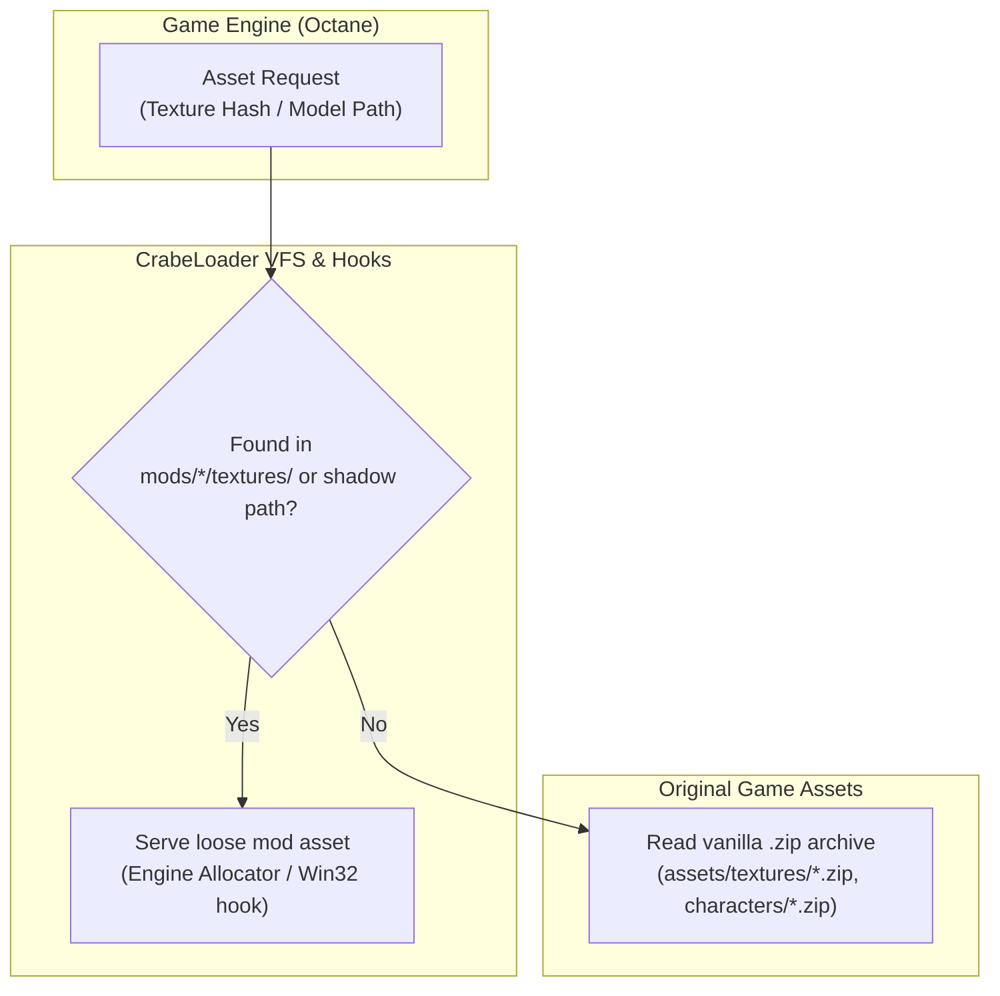

# Asset Replacement Guide: Textures, Meshes, UI & Audio

A comprehensive developer guide for replacing existing game assets (textures, 3D models, user interface icons, audio soundbanks, and world props) in **Disney Infinity 3.0: Gold Edition** using **CrabeLoader**.

---

## 1. Overview & Architecture

Disney Infinity 3.0 uses Avalanche Software's proprietary **Octane engine**. In the vanilla retail game, assets are packaged into compressed, encrypted archives:
* **Textures**: `.tbody` files (Direct3D DDS containers) packed into 256 indexed archives (`assets/textures/00.zip` through `ff.zip`).
* **3D Geometry**: Vertex stream buffers (`.vbuf`) and index buffers (`.ibuf`) packaged alongside Octane scene graphs (`.oct`) and skeletons (`.bent`).
* **Materials**: `.mtb` descriptor bundles linking shaders, render states, and 64-bit texture hashes.
* **Audio**: FMOD sound events and sample banks (`.fev` and `.fsb`).

### Zero-Touch Modding with CrabeLoader
With CrabeLoader, you **never** modify or overwrite the original vanilla `.zip` archives. Instead, CrabeLoader operates at two complementary levels:
1. **Engine Asset Loader Hook (VFS for Textures)**: Intercepts texture requests by 64-bit hash directly in memory before the engine reads from `assets/textures/<xx>.zip`. Loose `.tbody` files in `mods/<mod>/textures/` are served with zero latency and can be hot-reloaded live with **`F4`**.
2. **Win32 File System Shadowing**: Intercepts `CreateFile`, `GetFileAttributes`, and archive access. Placing a file or sub-archive inside `mods/<mod>/` shadows the corresponding game path.



---

## 2. Replacing Textures (`.tbody`)

Textures in Disney Infinity 3.0 are stored in the `.tbody` format. A `.tbody` file is a standard Microsoft DirectDraw Surface (DDS) file, typically with an optional 16-byte Octane header.

### 2.1. Supported DDS Texture Formats
* **DXT1 / BC1**: Standard diffuse maps without alpha, or with 1-bit alpha punch-through.
* **DXT5 / BC3**: Diffuse maps with smooth gradients/transparency, and tangent-space normal maps.
* **RGBA8**: Uncompressed 32-bit color (used for certain UI elements).
* **Mipmaps**: Always generate a complete mipmap chain down to 4×4 pixels to avoid shimmering and visual artifacts.

### 2.2. Locating Texture Hashes
Textures are referenced by an 8-byte (16-character hexadecimal) hash, such as `a5a0000050a40001`.

To find the hash of a texture you want to replace:
1. **Inspect `.mtb` Materials**: Decompile or inspect the model's `.mtb` material file. Each material pass explicitly references diffuse, specular, and normal texture hashes.
2. **RenderDoc / Graphics Debugger**: Attach RenderDoc to `DisneyInfinity3.exe`. Inspect shader resource bindings (`t0`, `t1`, `t2`) on draw calls to identify the active texture resource.
3. **CrabeLoader Asset Loader Probe**: Place an empty file named `crabe_probe_asset_loader.txt` next to `DisneyInfinity3.exe`. CrabeLoader will log every texture requested by the engine to `loader.log`.

### 2.3. Authoring and Deploying the Texture
1. Open your custom artwork in Photoshop, GIMP, or Paint.NET.
2. Export as DDS:
   - Diffuse: DXT1 (no alpha) or DXT5 (interpolated alpha), Generate Mipmaps.
   - Normal Map: DXT5 (BC3), Generate Mipmaps.
3. If necessary, prepend the 16-byte Octane `.tbody` header or convert using the pipeline tool.
4. Rename your file to `<hash>.tbody` (e.g. `a5a0000050a40001.tbody`).
5. Place it in your mod's directory:
   ```text
   mods/<my_mod>/
   ├── mod.json
   └── textures/
       └── a5a0000050a40001.tbody
   ```
6. **Live Reloading**: Launch the game. If you edit the texture while testing, press **`F4`** in-game to flush the material cache and DirectX 11 shader resource views.

---

## 3. Replacing 3D Models & Meshes (`.vbuf` / `.ibuf`)

Character and prop geometry in Octane is split into two binary stream buffers:
* **`.vbuf` (Vertex Buffer)**: Interleaved stream of vertex attributes:
  * Positions (`float3`)
  * Normals (`float3` or packed `half4`)
  * Tangents / Bitangents
  * UV coordinates (`float2` or `half2`)
  * Bone weights and indices (for skinned meshes: 4 weights + 4 bone indices)
* **`.ibuf` (Index Buffer)**: Sequential list of 16-bit or 32-bit indices defining triangle topology.

### 3.1. Structure of a Character / Prop Mesh Folder
```text
mods/<my_mod>/
└── characters/
    └── <actor_name>/
        ├── <actor_name>.bent       <- Bone hierarchy & bind-pose transforms
        ├── <actor_name>.oct        <- Octane scene graph, submesh definitions, bounding boxes
        ├── <actor_name>.mtb        <- Material bindings per submesh
        ├── <actor_name>_0.vbuf     <- Main mesh vertex buffer
        └── <actor_name>_0.ibuf     <- Main mesh index buffer
```

### 3.2. Steps to Replace a 3D Mesh
1. **Extract Original Assets**: Use QuickBMS with `disney_infinity_new.bms` to decompress the target character or prop archive (e.g. `assets/characters/emp_luke/emp_luke.zip`).
2. **Import into Blender**: Import the `.bent` skeleton and `.vbuf`/`.ibuf` geometry using the **DisneyInfinityCreator** Blender plugin.
3. **Modify or Replace Geometry**:
   * Align your new 3D model to the existing skeleton bones.
   * Transfer vertex weights (*Weights > Transfer Weights*) so your mesh moves naturally with the original animations.
   * Ensure materials and UV maps correspond to your textures.
4. **Export `.vbuf` and `.ibuf`**:
   * Export the new vertex and index streams via DisneyInfinityCreator.
   * If replacing an existing character's mesh directly in a mod clone, keep the exact file naming `<actor_name>_0.vbuf`.
5. **Place in Mod Directory**: Copy the generated `.vbuf` and `.ibuf` files into `mods/<my_mod>/characters/<actor_name>/`.

---

## 4. Replacing UI & HUD Icons

HUD portraits, character selection cards, and Toy Box catalog thumbnails consist of an Octane `.tbody` texture accompanied by an 80-byte `.mtb` material descriptor.

### 4.1. Fast-Track Icon Generation
The CrabeLoader character pipeline provides automated HUD icon conversion:

```powershell
python tools/character_pipeline/build_character.py `
    --base EMP_Luke `
    --name SOR_Sora `
    --mod sora `
    --icon path/to/portrait_512x512.png
```

### 4.2. Manual Icon Deployment
If you are authoring an icon manually:
1. Create a 256×256 or 512×512 square PNG with transparent background.
2. Export as DDS DXT5 (with mipmaps) and save as `<icon_hash>.tbody`.
3. Create the 80-byte companion `<actor_name>.mtb` file pointing to `<icon_hash>`.
4. Place both in `mods/<my_mod>/textures/`.
5. Reference the icon in your `mod.json`:
   ```json
   {
     "id": "my_custom_mod",
     "name": "My Custom Mod",
     "version": "1.0.0",
     "character": {
       "name": "MY_CustomHero",
       "displayName": "Custom Hero",
       "icon": "MY_CustomHero"
     }
   }
   ```

---

## 5. Replacing Audio & Sound Effects

Disney Infinity 3.0 uses the **FMOD Ex** audio engine:
* **`.fev` (FMOD Event File)**: Defines sound events, volume envelopes, pitch randomization, and 3D falloff parameters.
* **`.fsb` (FMOD Sound Bank)**: Contains the compressed audio sample waveforms (IMA ADPCM, MP3, or Vorbis).

### 5.1. Audio File Locations
Vanilla audio banks reside in `assets/audio/`:
* `assets/audio/characters/`: Voice lines, grunts, special move sound effects.
* `assets/audio/music/`: Playset ambient music and combat themes.
* `assets/audio/sfx/`: Weapon impacts, lightsaber hums, explosion effects.

### 5.2. Shadowing Audio Banks
1. Identify the target soundbank (e.g. `assets/audio/characters/emp_luke.fsb`).
2. Use FMOD SoundBank Generator or FMOD Event Player 4.44 to build a replacement `.fsb` with matching event names and sound IDs.
3. Place your modified `.fsb` into your mod directory mirroring the relative game path:
   ```text
   mods/<my_mod>/
   └── audio/
       └── characters/
           └── emp_luke.fsb
   ```
4. CrabeLoader's Win32 file hook intercepts the open call and delivers your custom soundbank to the FMOD driver.

---

## 6. Summary: Asset Types & Target Locations

| Asset Type | File Extension | Mod Destination Folder | Interception Mechanism |
| :--- | :--- | :--- | :--- |
| **Loose Textures** | `.tbody` | `mods/<mod>/textures/<hash>.tbody` | `EngineAssetLoader` VFS hook (Hot-reload with `F4`) |
| **3D Meshes** | `.vbuf`, `.ibuf` | `mods/<mod>/characters/<actor>/` | Win32 file hook / Actor clone registry |
| **Skeletons** | `.bent` | `mods/<mod>/characters/<actor>/` | Win32 file hook / Actor clone registry |
| **Materials** | `.mtb` | `mods/<mod>/characters/<actor>/` or `textures/` | Win32 file hook / VFS |
| **HUD Icons** | `.tbody` + `.mtb` | `mods/<mod>/textures/` | VFS texture & material descriptor |
| **Audio Banks** | `.fsb`, `.fev` | `mods/<mod>/audio/...` | Win32 file hook shadowing |
| **World Props** | `.zip` or loose | `mods/<mod>/props/...` or `assets/...` | Win32 file hook shadowing |

