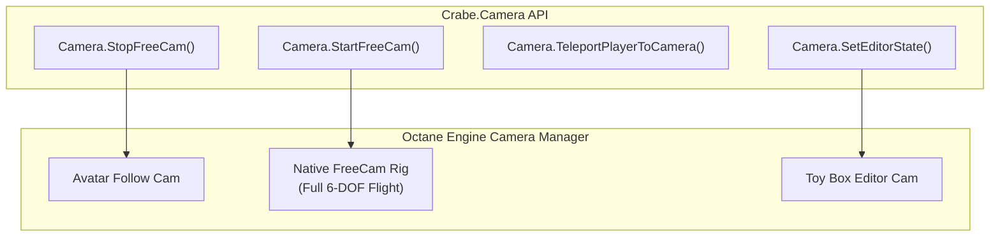

# Camera Control, Freecam & Cinematic Tools

A complete developer guide to controlling cameras, enabling the engine's internal **Free Camera**, manipulating the **Toy Box Editor Camera**, and scripting cinematic sequences in **Disney Infinity 3.0** via **CrabeLoader's Camera API** (`Crabe.Camera`).

---

## 1. Overview & Architecture

In Disney Infinity 3.0's Octane engine, camera control is divided into distinct systems:
1. **Avatar Camera**: The standard third-person orbital camera tethered to the player's character.
2. **Toy Box Editor Camera**: Detached fly-through camera active while editing the Toy Box (`Editor::ObjectMode`).
3. **Customize Camera Rig**: Orbit camera focused on a specific customizable actor.
4. **Engine Native FreeCam (`FreeCam`)**: The internal debug free-flight camera present in the engine binary. In retail builds, the debug keyboard shortcuts were stripped, but the underlying state machine remains fully intact.

CrabeLoader directly exposes the native `FreeCam` state machine through `Crabe._engineFreeCamera`, wrapped by the friendly Lua module `Crabe.Camera` (`src/api/26_camera.lua`).



---

## 2. The Native Freecam API

The native Freecam provides true 6-degrees-of-freedom flying:
* **Gamepad**: Left stick moves, Right stick looks, Triggers control elevation (Up/Down).
* **Keyboard/Mouse**: WASD moves, Mouse looks, Space / C for vertical movement.

### 2.1. Starting and Stopping the Freecam
```lua
Crabe = Crabe or {}
local Camera = Crabe.Camera

-- Toggle Freecam on/off
if Camera.IsFreeCamActive() then
    Camera.StopFreeCam()
    print("Avatar camera restored.")
else
    local ok = Camera.StartFreeCam()
    if ok then
        print("Free camera engaged. Fly freely!")
    else
        print("Failed to engage Freecam (no active world/camera scene).")
    end
end
```

### 2.2. Automatic HUD Suppression
When `Camera.StartFreeCam()` is called, CrabeLoader automatically calls `Game.SuppressHud(true)` to hide the player HUD, mini-map, and crosshairs for clean cinematic capture. When stopping, `Game.SuppressHud(false)` restores the UI.

### 2.3. Teleporting Player to Camera
While in Freecam, you can fly to any location in the world and warp your avatar directly to the camera's current position:

```lua
-- Teleports player avatar to where the freecam is currently looking
local success = Camera.TeleportPlayerToCamera()
if success then
    print("Player teleported to camera position!")
end
```

---

## 3. Toy Box Editor Camera

If you want to place the camera into the Toy Box builder view:

```lua
-- Available states: "Editor::IdleMode", "Editor::ObjectMode", "Editor::SparkMode"
Camera.SetEditorState("Editor::ObjectMode")
```

To exit editor mode:
```lua
Camera.SetEditorState("Editor::IdleMode")
```

---

## 4. World Reload Safety (`forgetStaleFreeCam`)

When a player enters a door or loads a new world, the scene graph and camera instances are completely torn down by the engine.

CrabeLoader tracks the **scene generation index**. If a world reload occurs while Freecam is active:
* The flag is automatically invalidated so the game never crashes trying to step a destroyed camera scene.
* The next call to `Camera.StartFreeCam()` queries the engine afresh rather than relying on stale pointers.

---

## 5. Practical Example: Cinematic Photo Mode Script

Here is a complete, production-ready Photo Mode script for your mod:

```lua
Crabe = Crabe or {}
local Camera = Crabe.Camera

local isPhotoMode = false

function togglePhotoMode()
    if isPhotoMode then
        Camera.StopFreeCam()
        isPhotoMode = false
        Crabe.Events.emit("ui_toast", "Photo Mode: OFF")
    else
        if Camera.StartFreeCam() then
            isPhotoMode = true
            Crabe.Events.emit("ui_toast", "Photo Mode: ON (WASD to fly, F to warp avatar)")
        end
    end
end

-- Bind to a key using Crabe.Input
Crabe.Mod.register({
    name = "PhotoModeMod",
    onUpdate = function(dt)
        -- Press 'P' (Virtual Key 0x50) to toggle Photo Mode
        if Crabe.Input and Crabe.Input.isKeyPressed(0x50) then
            togglePhotoMode()
        end

        -- While in Photo Mode, press 'F' (0x46) to teleport avatar to camera
        if isPhotoMode and Crabe.Input and Crabe.Input.isKeyPressed(0x46) then
            Camera.TeleportPlayerToCamera()
            Crabe.Events.emit("ui_toast", "Avatar Teleported!")
        end
    end,
    onShutdown = function()
        if isPhotoMode then
            Camera.StopFreeCam()
        end
    end
})
```
