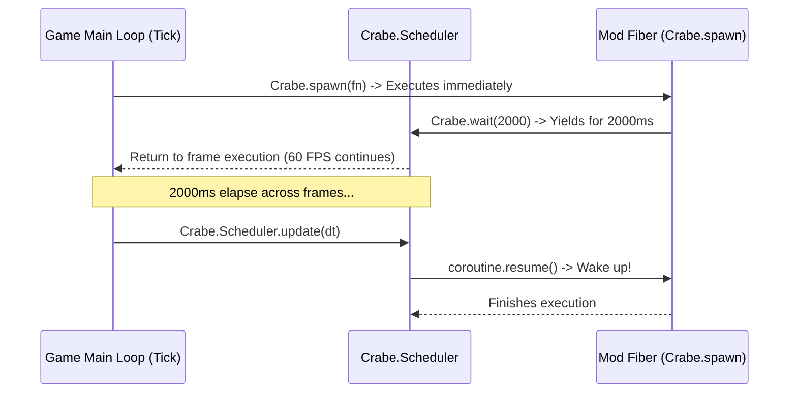

# Async Coroutines, Fibers & Timers

A developer guide to writing non-blocking asynchronous scripts, countdown timers, delayed sequences, and periodic polling loops in **Disney Infinity 3.0** using **CrabeLoader's Coroutine Engine** (`Crabe.spawn` and `Crabe.wait`).

---

## 1. Overview & Motivation

In game development, blocking operations are fatal:
* If you run `os.execute("sleep 2")` or a `while time() < target` loop in Lua, the **main game thread stops completely**. The game freezes, DirectX 11 stops rendering frames, and the OS marks the application as "Not Responding".
* Modders often need delays (e.g. wait 3 seconds before spawning a wave, or grant 10 seconds of invulnerability).

### The Cooperative Fiber Solution:
CrabeLoader implements a cooperative fiber scheduler (`Crabe.Scheduler` in `src/api/02_coroutine_engine.lua`):
* Fibers run cooperatively using Lua coroutines.
* Calling `Crabe.wait(ms)` yields the fiber and stores its target `wakeTime`.
* The tick dispatcher automatically advances `Crabe.Scheduler._currentTime` by the frame delta and resumes sleeping fibers with zero CPU spinning.



---

## 2. Basic Usage: `Crabe.spawn` & `Crabe.wait`

### 2.1. Spawning a Timed Sequence
```lua
Crabe = Crabe or {}

-- Launch an asynchronous fiber
Crabe.spawn(function()
    print("Countdown starting...")

    Crabe.wait(1000) -- Wait 1,000 ms (1 second)
    print("3...")

    Crabe.wait(1000)
    print("2...")

    Crabe.wait(1000)
    print("1...")

    Crabe.wait(1000)
    print("GO! Spawning boss...")
    Game.SpawnItemMany("INV_NPC_TCW_NiktoThug_Bruiser", 1)
end)
```
While this countdown runs over 4 seconds, the game continues rendering smoothly at 60 FPS without dropping a single frame.

---

## 3. Practical Use Cases

### 3.1. Temporary Buff / Ability Cooldown
```lua
function activateSuperSpeed(durationSeconds)
    Crabe.spawn(function()
        local hero = Game.GetAvatarHandle()
        print("Super speed activated!")
        Game.SetActorSpeedScale(hero, 3.0)

        -- Wait for the buff duration
        Crabe.wait(durationSeconds * 1000)

        Game.SetActorSpeedScale(hero, 1.0)
        print("Super speed expired.")
    end)
end
```

### 3.2. Periodic Polling Loop (Low CPU Usage)
Instead of checking a heavy condition every frame in `onUpdate`, poll once every 500ms:

```lua
Crabe.spawn(function()
    while true do
        Crabe.wait(500) -- Check twice per second

        local handle = Game.GetAvatarHandle()
        if handle then
            local x, y, z = Game.ActorPosition(handle)
            -- Check if player fell below the map
            if y and y < -50.0 then
                print("Player fell out of world! Teleporting to safety...")
                Game.PlaceActor(handle, 0, 10, 0)
            end
        end
    end
end)
```

### 3.3. Smooth Coordinate Interpolation (Lerping)
```lua
function smoothMove(handle, targetX, targetY, targetZ, durationSeconds)
    Crabe.spawn(function()
        local startX, startY, startZ = Game.ActorPosition(handle)
        if not startX then return end

        local elapsed = 0
        local stepMs = 16 -- ~60 updates per second

        while elapsed < durationSeconds do
            Crabe.wait(stepMs)
            elapsed = elapsed + (stepMs / 1000.0)

            local t = math.min(1.0, elapsed / durationSeconds)
            -- Smoothstep interpolation
            local smoothT = t * t * (3 - 2 * t)

            local curX = startX + (targetX - startX) * smoothT
            local curY = startY + (targetY - startY) * smoothT
            local curZ = startZ + (targetZ - startZ) * smoothT

            Game.PlaceActor(handle, curX, curY, curZ)
        end
    end)
end
```

---

## 4. Error Handling in Fibers

If an error occurs inside a fiber, CrabeLoader catches the failure, logs the exact callstack to `loader.log`, and discards the dead fiber without crashing the game engine or halting other scheduled fibers.
