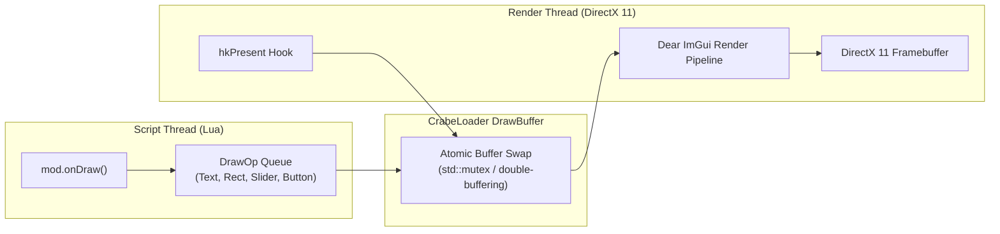

# 2D Drawing Primitives & Dear ImGui Overlays

A comprehensive developer guide to rendering custom in-game 2D graphics, HUD elements, debug overlays, and interactive menus in **Disney Infinity 3.0** using **CrabeLoader's DrawBuffer** and **Dear ImGui** (`onDraw` & `Crabe.ImGui`).

---

## 1. Overview & Architecture

Calling Direct3D 11 draw functions directly from Lua is illegal and leads to immediate thread races or engine crashes:
* The game's script engine runs on the **main game thread**.
* Direct3D 11 rendering occurs on the **render thread**.

### The Decoupled DrawBuffer Solution:
CrabeLoader implements a thread-safe, double-buffered command queue (`crabe::presentation::DrawBuffer`):
1. During the frame, Lua scripts record drawing instructions (`DrawOp`) into an isolated thread-local buffer via `onDraw`.
2. When the render thread executes the hooked `IDXGISwapChain::Present`, the buffer is swapped and replayed with 100% thread safety at full framerate.



---

## 2. Rendering Custom ImGui Windows (`onDraw`)

Mods create UI windows by registering an `onDraw` callback inside `Crabe.Mod.register`.

### 2.1. Basic Window Example:
```lua
Crabe = Crabe or {}

local showWindow = true
local playerSpeed = 1.0
local unkillable = false

Crabe.Mod.register({
    name = "MyCustomHudMod",

    onDraw = function()
        if not showWindow then return end

        local ImGui = Crabe.ImGui
        if not ImGui then return end

        -- Set initial window size and position
        ImGui.SetNextWindowSize(300, 220, "FirstUseEver")

        if ImGui.Begin("Hero Controller & HUD", true) then
            ImGui.TextColored(0.2, 0.8, 1.0, 1.0, "★ Hero Control Panel")
            ImGui.Separator()

            -- Toggle Checkbox
            local clicked, newValue = ImGui.Checkbox("Cannot be defeated", unkillable)
            if clicked then
                unkillable = newValue
                Game.SetActorState(Game.GetAvatarHandle(), "Unkillable", unkillable)
            end

            -- Slider
            local changed, newSpeed = ImGui.SliderFloat("Move Speed", playerSpeed, 0.5, 3.0)
            if changed then
                playerSpeed = newSpeed
                Game.SetActorSpeedScale(Game.GetAvatarHandle(), playerSpeed)
            end

            -- Action Button
            if ImGui.Button("Add 1,000 Sparks") then
                Game.AddToInventory("Items.money", 1000)
            end

            ImGui.End()
        end
    end
})
```

---

## 3. Supported ImGui Widgets (`Crabe.ImGui`)

| Function | Parameters | Description |
| :--- | :--- | :--- |
| `Begin(title, closable)` | `title` (str), `open` (bool) | Starts a new draggable window. |
| `End()` | None | Closes the current window scope. |
| `Text(text)` | `text` (str) | Renders standard text. |
| `TextColored(r, g, b, a, text)`| `r, g, b, a` (0.0-1.0), `text` | Renders colored text. |
| `Button(label)` | `label` (str) | Renders a clickable button. Returns `bool clicked`. |
| `Checkbox(label, state)` | `label` (str), `state` (bool) | Checkbox toggle. Returns `bool clicked, bool newState`. |
| `SliderFloat(label, val, min, max)`| `label`, `val`, `min`, `max` | Floating-point slider. Returns `bool changed, float newVal`. |
| `SliderInt(label, val, min, max)` | `label`, `val`, `min`, `max` | Integer slider. Returns `bool changed, int newVal`. |
| `InputText(label, text, maxLen)` | `label`, `text`, `maxLen` | Interactive text field. Returns `bool changed, str newText`. |
| `SameLine()` | None | Keeps the next widget on the same horizontal line. |
| `Separator()` | None | Horizontal divider rule. |

---

## 4. 2D Drawing Primitives (Custom HUD Gauges)

CrabeLoader also supports raw 2D shape drawing directly onto the screen viewport (`Crabe.Draw`):

```lua
-- Draws a custom stamina or health bar on screen
Crabe.Mod.register({
    name = "HealthBarMod",
    onDraw = function()
        local Draw = Crabe.Draw
        if not Draw then return end

        local screenX, screenY = 50, 50
        local barWidth, barHeight = 200, 20
        local healthPct = 0.75 -- 75% health

        -- Background (Dark Grey)
        Draw.RectFilled(screenX, screenY, barWidth, barHeight, 0x80202020)

        -- Health Fill (Green)
        Draw.RectFilled(screenX, screenY, barWidth * healthPct, barHeight, 0xFF00FF00)

        -- Border (White)
        Draw.Rect(screenX, screenY, barWidth, barHeight, 0xFFFFFFFF, 1.5)

        -- Text Label
        Draw.Text(screenX + 10, screenY + 2, "HP: 75 / 100", 0xFFFFFFFF)
    end
})
```

---

## 5. The Built-in ImGui Developer Overlay (`Insert`)

CrabeLoader includes a pre-built interactive overlay:
* Press **`Insert`** (or configured toggle key in `crabe.toml`) anywhere in game to open the **CrabeLoader Control Panel**.
* **Live Console**: Inspect stdout, script errors, and warnings in real-time.
* **Mod Manager**: View all loaded mods, their execution times, and quarantine status.
* **Memory & VFS Inspector**: Inspect active VFS texture intercepts and memory usage.
