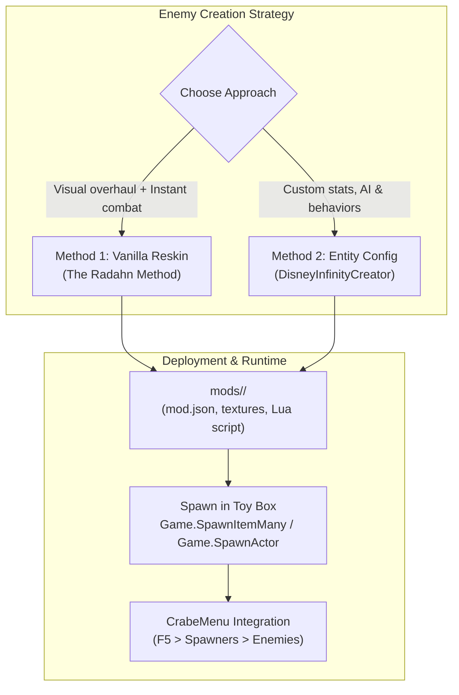

# Creating Enemies, Bosses & NPCs in Disney Infinity 3.0

A complete developer tutorial on creating custom hostile enemies, bosses, allies, and interactive NPCs in **Disney Infinity 3.0: Gold Edition** using **CrabeLoader** and **DisneyInfinityCreator**.

---

## 1. Overview & Architecture

In Disney Infinity 3.0's Octane engine, dynamic entities fall into several primary categories:
* **Playable Avatars (`Avatar`)**: Controlled directly by player input (e.g. Luke Skywalker, Sora).
* **Enemies (`Enemy`)**: Autonomous AI entities with aggressive state machines, hostile faction alignment, attack combos, and defeat loot drops.
* **Allies & Followers (`Ally`)**: AI-driven companions that target hostile enemies and escort the player.
* **Townspeople & NPCs (`Townsperson` / `NPC`)**: Non-combatant interactive characters found in the Toy Box Hub and playsets.

There are two primary approaches to creating a custom enemy in CrabeLoader:
1. **The Archetype Reskin Method (Recommended for Combatants)**: Shadow an existing vanilla enemy's 3D model and textures while retaining their battle-tested AI, animations, and sound effects (e.g. creating **Promised Consort Radahn** over a Star Wars Nikto Thug).
2. **The Custom Entity Configuration Method**: Configure AI behavior, health, damage, aggro range, and factions using **DisneyInfinityCreator** (`npc_config.py`) and spawn via dynamic Lua scripts.



---

## 2. Method 1: The Vanilla Reskin Method (The Radahn Method)

This is the fastest, most reliable method for creating custom bosses. It guarantees that the enemy possesses complete AI state machines, pathfinding, attack strings, debris physics, and hitboxes without stability issues.

### 2.1. Practical Example: Radahn over `TCW_NiktoThug_Bruiser`
In the **RadahnPrime** mod (`E:\Dev\DIM2\RadahnPrime`), Radahn is built as a reskin of the Star Wars Clone Wars bruiser:

```text
mods/radahn/
├── mod.json
├── radahn.lua                                    <- Toy Box spawner & menu registration
├── characters/
│   └── tcw_enemies/
│       └── tcw_niktothug_bruiser.zip             <- Custom Radahn model & mesh buffers
├── textures/
│   ├── 14a0000050a40001.tbody                    <- Loose diffuse atlas
│   └── 34a0000050a40002.tbody                    <- Loose normal map
└── skilltrees/
    └── TCW_NiktoThug_FastDebris_Brute.patch      <- Custom health & damage scaling
```

### 2.2. Selecting a Vanilla Enemy Archetype
Choose an archetype that closely matches your intended enemy's proportions and fighting style:

| Archetype Name | Source | Combat Style / Role |
| :--- | :--- | :--- |
| `INV_NPC_TCW_NiktoThug_Bruiser` | Star Wars: Clone Wars | Heavy brawler, ground slam, aggressive melee combos |
| `INV_NPC_TCW_BattleDroid_Blaster` | Star Wars: Clone Wars | Ranged shooter, ranged cover AI |
| `INV_NPC_SYR_Symbiote_Goon` | Marvel: Spider-Man | Agile fast attacker, wall leaps, leap strikes |
| `INV_NPC_ULTRON_Drone` | Marvel: Avengers | Flying or hovering ranged attacker |
| `INV_NPC_PIR_Captain_Guard` | Pirates of the Caribbean | Sword fighter with parry and counter-attacks |

### 2.3. Shadowing the Model and Textures
1. Extract the base enemy archive (e.g. `characters/tcw_enemies/tcw_niktothug_bruiser.zip`).
2. Replace the `.vbuf` and `.ibuf` mesh buffers with your new 3D model, rigged to the Nikto skeleton.
3. Put the replacement archive in `mods/<mod>/characters/tcw_enemies/tcw_niktothug_bruiser.zip` or provide loose `.tbody` textures in `mods/<mod>/textures/`.

### 2.4. Writing the Lua Spawner Script
Create a Lua script inside your mod (e.g. `radahn.lua`):

```lua
-- Radahn: Custom Boss Spawner
Crabe = Crabe or {}

local ENEMY_ITEM = "INV_NPC_TCW_NiktoThug_Bruiser"

local function spawn(count)
    -- Game.SpawnItemMany places the entity using the Toy Box placement engine
    -- This guarantees proper ground snapping and physics initialization
    local placed = Game.SpawnItemMany(ENEMY_ITEM, count)
    return string.format("Radahn: %d spawned", placed)
end

-- Register into CrabeMenu under a dedicated Bosses category
if Crabe.Menu and Crabe.Menu.registerInCategory then
    Crabe.Menu.registerInCategory("Bosses", {
        label = "Spawn Consort Radahn (Boss)",
        action = function() return spawn(1) end,
    })
    Crabe.Menu.registerInCategory("Bosses", {
        label = "Spawn 3 Radahns (Horde)",
        action = function() return spawn(3) end,
    })
end
```

---

## 3. Method 2: Custom Entity Configuration via DisneyInfinityCreator

For advanced NPCs and custom enemies requiring fine-tuned stats, factions, and behaviors, use the **DisneyInfinityCreator** entity framework (`DisneyInfinityCreator/src/core/npc_config.py`).

### 3.1. Entity Parameters

```python
from core.npc_config import EntityConfig, EntityType, Faction

boss_config = EntityConfig(
    entity_type=EntityType.ENEMY,
    faction=Faction.ENEMIES,
    max_health=2500,           # Massive boss health pool
    base_damage=85,            # High attack damage
    move_speed=1.25,           # Fast pursuit speed
    aggro_range=25.0,          # Large vision cone / aggro radius
    behavior="Hostile",        # Hostile, Patrol, Follower, or Passive
    animations={
        "idle": "Idle_Combat",
        "walk": "Run_Forward",
        "attack": "Combo_Slash_Triple",
        "death": "Knockback_Defeat"
    }
)
```

### 3.2. Supported Behaviors & Factions

| Behavior | Description |
| :--- | :--- |
| `Hostile` | Aggressively targets and engages players and friendly NPCs within `aggro_range`. |
| `Patrol` | Follows designated waypoint markers or path nodes until provoked. |
| `Follower` | Accompanies the player avatar, attacking targets that engage the player. |
| `Passive` | Does not engage in combat; plays ambient animations and flees on damage. |

| Faction | Interaction Rules |
| :--- | :--- |
| `Enemies` | Hostile to `Heroes`, neutral to other `Enemies`. |
| `Heroes` | Friendly to Player 1 & 2, hostile to `Enemies`. |
| `Neutral` | Does not attack unless directly provoked. |
| `Townsperson` | Civilians; triggers dialog bubbles or Toy Box missions. |

### 3.3. Generated Registration Code
`DisneyInfinityCreator` automatically compiles your configuration into runtime Lua registration code:

```lua
-- Custom Boss Registration
Crabe = Crabe or {}
Crabe.Enemies = Crabe.Enemies or {}
Crabe.ModdedCharacters = Crabe.ModdedCharacters or {}

local ACTOR = "BOSS_Radahn"
local NAME = "Consort Radahn"

local function spawn(pos)
    pos = pos or { x = 0, y = 0, z = 0 }
    if type(Game) == "table" and type(Game.SpawnActor) == "function" then
        return Game.SpawnActor(ACTOR, pos.x or 0, pos.y or 0, pos.z or 0)
    end
    -- Fallback to Toy Box spawner if SpawnActor native is not loaded
    if type(Game) == "table" and type(Game.SpawnItemMany) == "function" then
        return Game.SpawnItemMany("INV_NPC_" .. ACTOR, 1)
    end
end

Crabe.Enemies["boss_radahn"] = {
    name = NAME,
    actor = ACTOR,
    type = "Enemy",
    faction = "Enemies",
    health = 2500,
    damage = 85,
    speed = 1.25,
    behavior = "Hostile",
    spawn = spawn,
}

Crabe.ModdedCharacters["boss_radahn"] = {
    name = NAME .. " (Boss)",
    action = spawn,
}
```

---

## 4. Spawning in the Game

### 4.1. Spawning in the Toy Box
In the Toy Box, the safest and cleanest way to spawn an enemy is via `Game.SpawnItemMany`:
```lua
-- Spawns 2 enemies in front of the active player
Game.SpawnItemMany("INV_NPC_TCW_NiktoThug_Bruiser", 2)
```
* **Collision Raycasting**: The Toy Box engine automatically performs a downward physics raycast to snap the spawned actor onto the terrain or Toy Box block.
* **Toy Box Budget**: Enemies spawned via `SpawnItemMany` correctly register with the Toy Box enemy cap and enemy wave generators.

### 4.2. Spawning at Coordinates
If you know the world coordinates (e.g. in a playset or custom mission script):
```lua
local x, y, z = 120.5, 10.0, -45.2
Game.SpawnActor("TCW_NiktoThug_Bruiser", x, y, z)
```

---

## 5. In-Game Testing & Verification

1. Launch **Disney Infinity 3.0** with CrabeLoader installed.
2. Enter the **Toy Box** (or load a custom Toy Box map).
3. Press **`F5`** to open **CrabeMenu**.
4. Navigate to your custom category (e.g. **Bosses** or **Spawners > Enemies**).
5. Select your enemy and press **Enter** (or `A` on gamepad) to spawn.
6. **Live Iteration**: If you tweak your Lua spawner or behavior script, press **`F4`** in-game to hot-reload all mod scripts without quitting the game!

