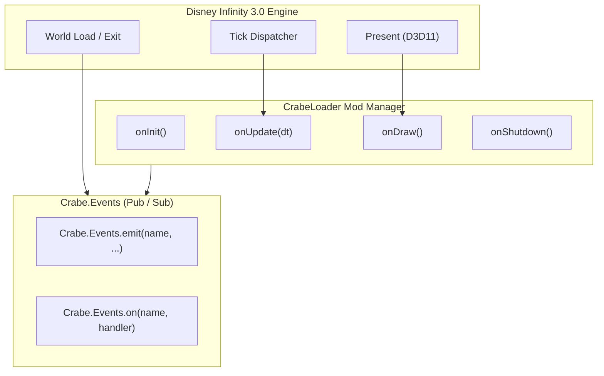

# Mod Lifecycle & Unified Event Bus

A comprehensive guide to the **CrabeLoader Mod Lifecycle** and **Unified Event Bus** (`Crabe.Events` & `Crabe.Mod`). Learn how to initialize mods, listen to engine and game events, handle frame updates, and communicate between mods safely.

---

## 1. Overview & Architecture

CrabeLoader enforces strict isolation between mods through **per-mod Lua sandboxes** and a **generation-tracked lifecycle**. 

Key principles:
* **Decoupled Architecture**: Mods never directly call into other mods' private internals. All communication passes through the unified Event Bus (`Crabe.Events`).
* **Hot-Reload Safety**: When pressing **`F4`**, CrabeLoader tears down the current generation, revokes all event subscriptions, and reloads mod chunks in less than 50 ms without leaking memory.
* **Quarantine Protection (`02c_quarantine.lua`)**: If a mod's callback throws consecutive runtime errors, CrabeLoader automatically quarantines the faulty callback to prevent the entire game or other mods from crashing.



---

## 2. Mod Lifecycle: `Crabe.Mod.register`

Every mod can register lifecycle hooks with `Crabe.Mod.register`. This ensures proper ordering and allows CrabeLoader to track callback ownership.

### 2.1. Basic Lifecycle Template
Inside your mod's `main.lua`:

```lua
Crabe = Crabe or {}

Crabe.Mod.register({
    name = "MyAwesomeMod",

    -- Called once when the mod is loaded or reloaded
    onInit = function()
        Crabe.Log.info("MyAwesomeMod initialized successfully!")
    end,

    -- Called every game frame with the delta time in seconds
    onUpdate = function(dt)
        -- Perform light per-frame logic (timers, input checks)
    end,

    -- Called during the Direct3D 11 Present hook within Dear ImGui context
    onDraw = function()
        -- Render custom ImGui windows or 2D overlays
    end,

    -- Called when the mod is unloaded, reloaded (F4), or when the game exits
    onShutdown = function()
        -- Save persistent data, release resources
    end
})
```

### 2.2. Lifecycle Callback Details
| Callback | Frequency | Primary Usage |
| :--- | :--- | :--- |
| `onInit()` | Once at load / hot-reload | Register menu items, subscribe to events, load configs. |
| `onUpdate(dt)` | Every game frame (~60 FPS) | Non-visual game logic, tracking actors, updating positions. |
| `onDraw()` | Every render frame | Recording ImGui widgets (`Crabe.ImGui`) and draw commands. |
| `onShutdown()` | Once at teardown / reload | Persisting data to `Crabe.Storage`, releasing native hooks. |

---

## 3. The Unified Event Bus: `Crabe.Events`

The event bus implements a decoupled publish/subscribe pattern. Listeners are tracked by identity and automatically revoked on hot reload (**`F4`**), preventing orphaned closures.

### 3.1. Subscribing to Events (`Crabe.Events.on`)
```lua
-- Subscribe to an event
local handler = Crabe.Events.on("player_damaged", function(victimHandle, damageAmount)
    print(string.format("Actor %d took %d damage!", victimHandle, damageAmount))
end)

-- Unsubscribe manually if needed
Crabe.Events.off("player_damaged", handler)
```

### 3.2. One-Shot Listeners (`Crabe.Events.once`)
Executes the callback exactly once, automatically unregistering itself immediately before firing:

```lua
-- Runs only for the very first world loaded in this session
Crabe.Events.once("world_loaded", function(worldName)
    print("Welcome to " .. tostring(worldName) .. "! Welcome banner displayed.")
end)
```

### 3.3. Emitting Custom Events (`Crabe.Events.emit`)
Any mod can define and emit its own custom events. Handlers are invoked inside safe `pcall` wrappers, so a failure in one subscriber does not affect others:

```lua
-- Emit an event with arbitrary arguments
Crabe.Events.emit("boss_spawned", "Radahn", 2500, { x = 0, y = 10, z = 0 })
```

---

## 4. Built-in Engine & CrabeLoader Events

CrabeLoader emits several core events as the game runs:

| Event Name | Arguments | Description |
| :--- | :--- | :--- |
| `"world_loaded"` | `worldName` (string) | Fired when a world, playset, or Toy Box finishes loading. |
| `"world_exit"` | None | Fired when the player leaves a world back to the menu or hub. |
| `"player_spawned"` | `playerId`, `avatarHandle` | Fired when a player avatar spawns into the world. |
| `"portal_figure_placed"` | `slot` (0-2), `sku` | Fired when a physical or virtual figure is placed on the base. |
| `"portal_figure_removed"` | `slot` (0-2) | Fired when a figure is lifted from the base. |
| `"key_pressed"` | `vKey` (int) | Fired when a keyboard key is pressed down. |
| `"pad_button_pressed"` | `buttonId` (int) | Fired when a gamepad button is triggered. |

---

## 5. Inter-Mod Communication Example

Imagine **Mod A** tracks player achievements, and **Mod B** is a custom combat mod:

### Mod B (Combat Mod):
```lua
-- Inside Mod B when an enemy is defeated
function onEnemyDefeated(enemyName, points)
    Crabe.Events.emit("combat_kill", enemyName, points)
end
```

### Mod A (Achievements Mod):
```lua
-- Inside Mod A
local totalKills = 0

Crabe.Events.on("combat_kill", function(enemyName, points)
    totalKills = totalKills + 1
    if totalKills == 50 then
        Crabe.Events.emit("ui_notification", "Achievement Unlocked: Slayer!")
    end
end)
```
Neither mod requires a hard dependency on the other. If Mod A is not installed, Mod B continues running seamlessly.
