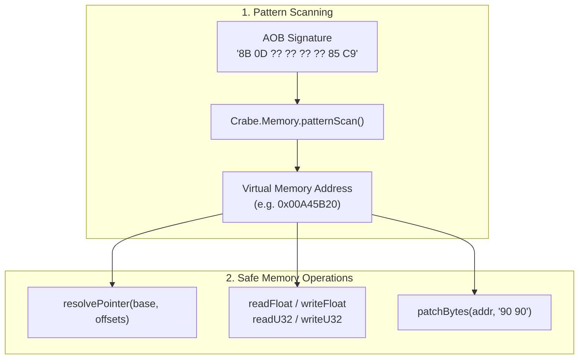

# Memory Scanning, Pointer Chains & Code Caves

A deep-dive technical reference on low-level process memory interaction, signature scanning (AOB), pointer resolution, runtime byte patching, and code caves in **Disney Infinity 3.0** via **CrabeLoader's Memory API** (`Crabe.Memory` & `Crabe.Input`).

---

## 1. Overview & Safety Architecture

CrabeLoader exposes low-level memory primitives from C++ into Lua (`src/api/24_memory.lua`).

### Core Safety Rules:
* **Structured Exception Handling (SEH)**: All memory reads and writes pass through vectored exception handlers. If an invalid memory address is accessed, CrabeLoader catches the page fault, prevents an Access Violation crash (`0xC0000005`), logs a warning, and safely returns `nil`.
* **Zero Direct Memory Writes for Known Gameplay Variables**: If an official native setter exists (such as `Game.PlaceActor` for coordinates or `Game.SetActorSpeedScale` for movement speed), prefer it over raw memory writes to avoid physics race conditions with Octane.



---

## 2. Signature Scanning (AOB / Array of Bytes)

Hard-coding memory addresses like `0x0084B120` is dangerous because game updates, DLCs, and ASLR shift offsets. Instead, use **IDA-style pattern scans**:

### `Crabe.Memory.patternScan(pattern)`
* **Parameters**: `pattern` (*string*): Hexadecimal byte sequence with `??` or `?` wildcards.
* **Returns**: `number? address`: The virtual address in memory, or `nil` if not found.

```lua
Crabe = Crabe or {}
local Memory = Crabe.Memory

-- Scan for the player camera state controller
local pattern = "8B 0D ?? ?? ?? ?? 85 C9 74 05 E8"
local matchAddr = Memory.patternScan(pattern)

if matchAddr then
    print(string.format("Pattern matched at address: 0x%08X", matchAddr))
else
    print("Pattern scan failed: no matching bytes found.")
end
```

---

## 3. Reading and Writing Memory Primitives

### 3.1. 32-bit Integers (`readU32` / `writeU32`)
```lua
local address = 0x0124A040

-- Read an unsigned 32-bit integer
local val = Memory.readU32(address)
print("Current value:", val)

-- Write a new value
local ok = Memory.writeU32(address, 1337)
```

### 3.2. Floating-Point Numbers (`readFloat` / `writeFloat`)
Used for speeds, timers, FOV, scale, and world gravity:

```lua
-- Read a float value (e.g. gravity scale)
local gravity = Memory.readFloat(gravityAddr)

-- Double the gravity
Memory.writeFloat(gravityAddr, gravity * 2.0)
```

### 3.3. Multi-Level Pointer Resolution
Game engines frequently organize objects into pointer graphs (`Entity -> Controller -> Transform`). CrabeLoader can resolve deep pointer chains in one step:

```lua
-- Resolves: [[[0x00A45B20] + 0x14] + 0x8] + 0x30
local resolvedAddr = Memory.resolvePointer(0x00A45B20, { 0x14, 0x8, 0x30 })
if resolvedAddr then
    local health = Memory.readFloat(resolvedAddr)
    print("Resolved health:", health)
end
```

---

## 4. Runtime Byte Patching (`patchBytes`)

You can modify game instructions on the fly (for example, NOPing out a jump instruction):

```lua
-- Replace a 2-byte conditional jump (74 08 -> JE) with two NOPs (90 90)
local hookAddr = 0x0052C140
local success = Memory.patchBytes(hookAddr, "90 90")
if success then
    print("Opcode patched successfully!")
end
```
CrabeLoader automatically calls `VirtualProtect` to apply `PAGE_EXECUTE_READWRITE` permissions, writes the bytes, flushes the CPU instruction cache via `FlushInstructionCache`, and restores original memory protections.

---

## 5. Direct Hardware Input Querying (`Crabe.Input`)

Alongside memory scanning, CrabeLoader provides hardware input state inspection (`src/api/24_memory.lua`):

```lua
local Input = Crabe.Input

-- Check if a key is currently held down
if Input.isKeyDown(0x20) then -- VK_SPACE
    -- Spacebar is down
end

-- Check if a key was just pressed this frame
if Input.isKeyPressed(0x46) then -- 'F' key
    print("F key pressed!")
end

-- Check Gamepad button states (XInput format)
-- Button 0x1000 = A Button, 0x2000 = B Button
if Input.isGamepadButtonPressed(0x1000) then
    print("Gamepad 'A' Button pressed!")
end
```
