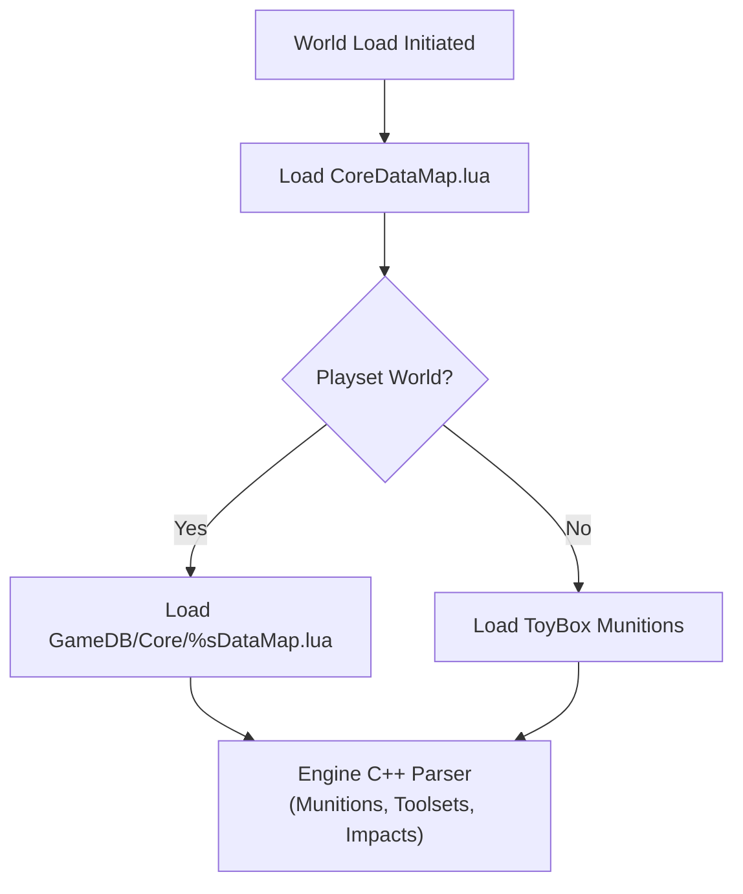

# Playset & DataMap Architecture: The "Any Character in Any Playset" Bypass

A technical reference guide detailing how Disney Infinity 3.0 (Octane Engine) loads level DataMaps, munitions, and toolsets, and the critical architectural side-effects introduced by the native Playset Bypass patches (`S12`-`S15`).

---

## 1. Vanilla DataMap & Munitions Loading Workflow

In the retail PC executable (`DisneyInfinity3.exe`), when a level loads, `StandAloneLoop::LoadDataMaps` (virtual address `0x143ACC0`) executes the following sequential steps:

1. **Loads Core DataMap**:
   The engine reads and executes `GameDB/Core/CoreDataMap.lua`.
   This script instantiates the global table `DataMap` with:
   - `DataMap.Playset._loadforallplaysets_.Files`: A master array containing files loaded unconditionally for **every** game mode (Toy Box, Playset, Hub).
2. **Loads Active Playset DataMap**:
   If the loaded world belongs to a Playset, the engine constructs the path `GameDB/Core/%sDataMap.lua` (e.g. `EmpireDataMap.lua`, `DoryDataMap.lua`) and executes it.
3. **Parses Registered Files**:
   The engine iterates over the registered files (`GameDB|<path>|<flag>|<type>`):
   - `|munitions`: Parsed into the C++ munitions registry (`MunitionsTable`).
   - `|toolset`: Registers the avatar weapon mapping, charge actions, and projectile spawners (`ToolSetTable`).
   - `|surfaceImpacts`: Registers physics impact decals and particles.



---

## 2. The Native Playset Bypass Patch (`S13 LoadAllDataMaps`)

The "Anyone Can Cook" / Playset Bypass patch flips several memory barriers to allow any avatar in any playset without brand-lock or figure resets:

```
Address: 0x143AD06
Original: 32 DB       (xor bl, bl  -> bl = 0)
Patched:  B3 01       (mov bl, 1   -> bl = 1)
```

### The Mechanism
In `StandAloneLoop::LoadDataMaps`, the register `bl` controls whether the engine should load a single level's DataMap or iterate over all playset DataMaps:
* When `bl == 0` (Vanilla): The engine directly calls `OpenGenieFile("GameDB/Core/%sDataMap.lua")` for the current playset name.
* When `bl == 1` (Patched by S13): The engine skips the per-level call and instead iterates over its internal C++ array of playset pointers (`[0x225F548] + 0x2F8`).

### The Critical Side-Effect
> [!CAUTION]
> **The Hard-Coded Playset Limitation:**
> In `DisneyInfinity3.exe` (PC Gold Edition), the native C++ playset array is **hard-coded to only 4 vanilla playsets**:
> 1. `TheCloneWars`
> 2. `Empire`
> 3. `PlaysetX` (Twilight of the Republic / Force Awakens)
> 4. `InsideOut`
>
> **DLC, custom, and Update 1.06 playsets (such as *Finding Dory* and *Marvel Battlegrounds*) do NOT exist in this internal array!**
>
> Therefore, when `S13` is active:
> - The engine **never** executes `GameDB/Core/DoryDataMap.lua`.
> - `in3_dor_dory_toolset.lua` and `munitions_dory.lua` are **never** loaded.
> - When playing as Dory or Nemo, pressing Fire (RMB / RT) attempts to read an active tool from `ToolSetTable`, finds a null handle, and **no projectiles are fired**.

---

## 3. The Modern Solution: Dynamic DataMap Injection

To guarantee 100% compatibility across all playsets (vanilla, custom, and Update 1.06), CrabeLoader and the Update 1.06 mod implement a dynamic chunk hook.

Because the engine **always** executes `DataMap.Playset._loadforallplaysets_.Files` for every loaded level regardless of S13, any extra files added to this table are loaded natively by Octane's C++ parser.

### Implementation Pattern (`Crabe.Hooks.patchChunk`)

```lua
Crabe.Hooks.patchChunk("DataMap", [[
local _G_root = (type(getfenv) == "function" and getfenv(0)) or _G or {}
if DataMap and DataMap.Playset then
    local extraFiles = {
        "GameDB|gamedb/core/munitions_toybox.lua|1|munitions",
        "GameDB|gamedb/toybox/surfaceimpacts.lua|1|surfaceImpacts",
        "GameDB|gamedb/core/munitions_dory.lua|1|munitions",
        "GameDB|gamedb/core/in3_dor_dory_toolset.lua|1|toolset",
        "GameDB|gamedb/core/in3_dor_nemo_toolset.lua|1|toolset",
        "GameDB|gamedb/dory/surfaceimpacts.lua|1|surfaceImpacts",
        "GameDB|gamedb/dory/assetdefs.lua|1|assetDefs",
        "GameDB|gamedb/dory/bitmasks.lua|1|bitMask",
        "GameDB|gamedb/core/dory_actors.lua|1|actorList",
    }
    local function addExtra(tbl)
        if not (tbl and tbl.Files) then return end
        local seen = {}
        for _, f in ipairs(tbl.Files) do seen[f] = true end
        for _, f in ipairs(extraFiles) do
            if not seen[f] then tbl.Files[#tbl.Files + 1] = f end
        end
    end

    -- Inject into the universal engine loader
    addExtra(DataMap.Playset._loadforallplaysets_)
    for _, ps in pairs(DataMap.Playset) do addExtra(ps) end
end
]])
```

### Best Practices for Munitions Tables
When creating custom or backported munitions tables (like `munitions_dory.lua`), **never** overwrite the global table directly (`MunitionsTable = { ... }`). Always perform a non-destructive recursive merge:

```lua
MunitionsTable = MunitionsTable or {}
local function mergeInto(dst, src)
    for k, v in pairs(src) do
        if type(v) == "table" then
            dst[k] = dst[k] or {}
            mergeInto(dst[k], v)
        else
            dst[k] = v
        end
    end
end
mergeInto(MunitionsTable, customMunitions)
```
