# CrabeLoader V2 — Disney Infinity Base & Figure Registry

*Disney Infinity 3.0 (PC)* shipped without support for the physical base: on PC every character comes from the **virtual reader**. CrabeLoader gives that hardware back to mods through two APIs:

- **`Crabe.Portal`** talks to a physical base. It connects, authenticates, detects figures, reads and decrypts what they store, drives the LEDs, and writes progression back safely.
- **`Crabe.Gateway`** talks to the **engine's own figure registry**. That registry is still complete in the PC build. A tag added there is a figure the game handles exactly as if a reader had reported it, under its own UID.

Both are primitives. What a figure *does* in the game belongs to the mod listening. The reference mod is [Disney Infinity Portal](https://github.com/LucasLhomme/DisneyInfinityPortal).

---

## 1. Architecture

```mermaid
flowchart LR
    BASE["Physical base (USB)"] --> TRANSPORT["Transport: HID / Xbox 360 / Xbox One (GIP)"]
    TRANSPORT --> PROTOCOL["DisneyBaseProtocol (no I/O, testable)"]
    PROTOCOL --> WORKER["PortalWorker thread"]
    WORKER --> QUEUE["Event queue"]
    QUEUE --> PORTAL["Crabe.Portal (game tick)"]
    PORTAL --> MOD["Mod (Lua)"]
    MOD --> GATEWAY["Crabe.Gateway"]
    GATEWAY --> ENGINE["Engine Gateway registry -> IGP profile records"]
    ENGINE -- "Gateway::Write* hooks" --> GATEWAY
```



- **The game thread never touches USB.** A dedicated worker owns the device, reconnects on hot-plug, and hands events over through a queue. `Crabe.Portal.update` drains that queue on every game tick.
- **`Crabe.Gateway` calls run on the game thread.** The engine announces a tag change to the game synchronously, before the call returns.
- **No game rule lives in C++.** SKUs, characters and progression policy all belong to the mod.

Code: `src/infrastructure/portal/` (base), `src/infrastructure/engine_gateway.cpp` (registry), `src/api/25_portal.lua` and `src/api/25b_gateway.lua` (Lua).

---

## 2. Supported bases and drivers

| Base | USB id | Transport | Driver | State |
|---|---|---|---|---|
| PS3 / PS4 / Wii / Wii U / PC | `0E6F:0129` | HID, 32-byte reports | none | written from the engine's driver, untested |
| Xbox 360 | `24C6:FA00` | WinUSB, Disney report behind a two-byte `0B 15` header | WinUSB (Zadig) | written from the engine's driver, untested |
| Xbox One | `0E6F:0229` | WinUSB, GIP with security handshake | WinUSB (Zadig) | **works in game** |

Windows' own Xbox driver loads for the Xbox One base, but exposes it neither to `Windows.Gaming.Input` nor to GameInput, so CrabeLoader cannot reach it that way. Replace it with WinUSB using [Zadig](https://zadig.akeo.ie/):
1. Select **Options > List All Devices**.
2. Pick **Disney Infinity Base**.
3. Choose WinUSB and click **Replace Driver**.

When no base answers, `Crabe.Portal.getStatus().diagnostic` names the missing piece, for example a base found but without WinUSB.

---

## 3. `Crabe.Portal`

| Call | Returns |
|---|---|
| `isConnected()` | `true` while a base answers |
| `getStatus()` | `{ connected, type, typeDescription, slot1Sku, slot2Sku, slot3Sku, diagnostic }` |
| `setLed(slot, r, g, b)` | slot `0` = all, `1` = Player 1, `2` = Player 2, `3` = playset / hexagon |
| `placeVirtualFigure(slot, sku)` / `removeVirtualFigure(slot)` | report a figure as a base would |
| `writeFigureProgress(slot, progress)` | `true` when a write was queued |
| `decodeSkillBits(hex)` / `encodeSkillBits(bits)` | the 8 skill bytes ⇄ `{ n, ... }` |

Events on `Crabe.Events`:

| Event | Arguments |
|---|---|
| `portalFigurePlaced` | `slot, sku, uid, progress` |
| `portalFigureRemoved` | `slot, uid` |

- **`uid`** is the figure's 7-byte UID in hex (`"04685c82173f80"`), or `""` for a virtual figure. A Lua number cannot hold 7 bytes exactly, so UIDs always travel as text.
- **`progress`** is what a physical character figure has saved: `{ level, experience, actionFlags, lastPlayed, skillBits }`. It is `nil` for virtual figures and for pieces.

### Writing progression back

`writeFigureProgress` follows the console's own rules, and adds a read-back check that the engine does not do:
- Only the experience block and the skill block are ever written: sectors 1-2, blocks 0-1. A hard guard in C++ refuses anything else.
- Each of those blocks exists twice on the figure. The write always goes to the **older** copy, with its sequence number advanced, so the current copy survives a figure lifted mid-write.
- Each written block is read back and compared. `loader.log` says `written and verified` or `NOT saved`.
- A pair that did not change is not written.

---

## 4. `Crabe.Gateway`

| Call | Returns |
|---|---|
| `isAvailable()` | `true` when the bridge resolved on this build |
| `addTag(uid, characterId, antenna, options)` | `true` when added |
| `removeTag(uid)` | `true` when removed |
| `virtualAvatar()` | character id of the virtual reader's avatar tag, or `nil` |
| `uidForId(id)` | UID of the virtual reader's tag for a character id |

- **`antenna`**: `0` is Player 1 and `1` is Player 2. The PC virtual reader always uses antenna 0.
- **`options`**: `{ experience, level, lastPlayed, actionFlags, owner, skillBits, watch }`.
  - Giving `skillBits` also sets the tag's progression, which the game needs to load a profile record for the UID.
  - With `watch = true`, every write the game makes to that tag is emitted as **`gatewayTagWrite`** `(uid, field, value)`.
  - `field` is one of `experience`, `level`, `lastPlayed`, `action`, `owner` or `progression`. Every value is a number except `progression`, which is a `{ n, ... }` list.

### Why per-figure progression works

The save keeps one profile record per **tag UID**, not per character. The virtual reader adds fake tags whose UID is the character id. A physical figure added under its real UID therefore gets **its own record**, and the game applies that record's level and skills by itself.

The game saves a record by calling the six UID-keyed `Gateway::Write*` functions. CrabeLoader hooks them and reports the writes for watched UIDs only.

Placing a figure on Player 1, as the reference mod does:

```lua
local virtual = Crabe.Gateway.virtualAvatar()
if virtual then Crabe.Gateway.removeTag(Crabe.Gateway.uidForId(virtual)) end
Crabe.Gateway.addTag(uid, sku, 0, {
    experience = progress.experience, level = progress.level, lastPlayed = progress.lastPlayed,
    actionFlags = progress.actionFlags, skillBits = progress.skillBits, watch = true,
})
```

The game accepts **one avatar per antenna**. A second avatar on an occupied antenna is rejected as invalid. That is why the virtual reader's avatar is removed first, then added back once the figure is lifted.

### Safety

- Every address is taken from the game profile (`di3-gold-steam-1.0`) and checked by its bytes before the first use:
  - each entry point's prologue;
  - the calls each function must make;
  - both globals, as the engine's own `ChangeAvatar` uses them.
- On any mismatch the bridge stays absent, `isAvailable()` is `false`, and `loader.log` says why.
- Calls into the engine run under CrabeLoader's SEH guard.
- When the game makes a reset (level, experience and skills all zero, owner 1), the reference mod refuses to copy it to the figure. That reset comes from the game's ownership-clearing path.

---

## 5. Figure data

A character figure is a MIFARE Mini tag, read through the base's `0xA2` command and written through `0xA3`.

- **Key:** each figure has its own AES-128 key, derived from its UID. The key is the first 16 bytes of a SHA-1 over a fixed base key, the text `(c) Disney 2013` and the UID, with each 4-byte word byte-reversed (the engine's `SHA1Result_LSB`). Blocks are AES-128-ECB.
- **Integrity:** the last 4 bytes of each block hold a CRC-32 of the first 12, stored big-endian. The CRC is reflected, polynomial `0xEDB88320`, with an initial value of 0 and no final XOR. An all-zero block means "never written".
- **Identity:** sector 0, block 1 holds the SKU (big-endian), the figure version and the magic `0xD11F`.
- **Experience block:** sectors 1 and 2, block 0. It holds the experience within the level (u32, big-endian), the level, the last played date, the action flags and a sequence number in byte 11.
- **Skill block:** sectors 1 and 2, block 1. Its first 8 bytes are the skill bits: bit *n* is `byte[n/8] & (1 << n%8)`.
- **Current copy:** the one with the newer sequence number, except that `0x00` beats `0xFF` (wrap-around). When both are 0 the sector 1 copy is current; when both are equal and non-zero, the sector 2 copy is.
- **Last played date** is packed as `(year-2013)<<26 | month<<22 | day<<17 | hour<<12 | minute<<6`.
- **Action flags:** `0x40` = max level reached, `0x80` = played in 2.0.

### Disney report protocol

| Message | Bytes |
|---|---|
| Request | `FF len cmd id data… checksum` |
| Reply | `AA len id data…` |
| Notification | `AB 04 antenna type lti change` |

| Command | Role |
|---|---|
| `0x80` | wake, with the 15 bytes `(c) Disney 2013`; replies with platform, hardware, protocol and firmware versions |
| `0xA1` | tag list |
| `0xB4` | tag UID |
| `0xA2` | read a block: `[lti, sector, block]` |
| `0xA3` | write a block: `[lti, sector, block, 16 bytes]`; result `0x00` = OK, `0x80` = tag gone, `0x84` = write error |
| `0x95` | LEDs |
| `0xB5` | scan interval |

Antennas: 1 = playset, 2 = Player 1, 3 = Player 2.

### Xbox One base (GIP)

- **Transport:** the base speaks GIP over WinUSB. Disney reports travel in GIP message **`0x21`** (non-system, 32 bytes), not `0x1F`.
- **Opening a session:** drain, IDENTIFY (the base answers with its descriptor), POWER ON, then the security handshake. The base accepts nothing else before the handshake completes.
- **Authentication is mandatory:** without it the base ignores `0x21`. It is the GIP security handshake v1, on GIP command `0x06`:
  1. `HOST_HELLO` carries 32 random bytes.
  2. The host requests `CLIENT_HELLO`, which carries the base's 32 random bytes.
  3. The host requests the `CERTIFICATE`: an "Xbox Accessories Class Prod CA 001" certificate embedding an RSA-2048 PKCS#1 public key.
  4. `HOST_SECRET` carries 48 random bytes encrypted with that key (PKCS#1 v1.5), sent chunked.
  5. `HOST_FINISH` is `P_SHA256(master, "Host Finished", SHA-256(transcript))`, where `master = P_SHA256(secret, "Master Secret", hostRandom || clientRandom)`.
  6. The host requests `CLIENT_FINISH`.
- **Finishing the handshake:** PDP firmwares never send `CLIENT_FINISH`. They only acknowledge the request at GIP level, and the host must then send the COMPLETE control `06 20 seq 02 | 01 00`, as Windows does. Asking for `CLIENT_FINISH` again hangs the base until it is unplugged. A base asking for handshake v2 is refused.
- **GIP framing:** each header is command, options, sequence, then a varint length. Option bits are `0x10` ACK, `0x20` internal, `0x40` chunk start and `0x80` chunked. The header length must be even, so an odd one pads its varint. Payloads longer than one 64-byte packet go in 54-byte chunks, each acknowledged, and an empty chunk ends them.

---

## 6. Testing without the game

- `test_portal_write.exe`: decryption, sealing and the double-buffered write against a simulated base holding a real figure's blocks.
- `portal_probe.exe`: the real worker in a console. Connects, cycles the LEDs, and prints figures and their progression.

What can only be checked in game is listed in [`docs/testing/manual_checklist.md`](../testing/manual_checklist.md).
