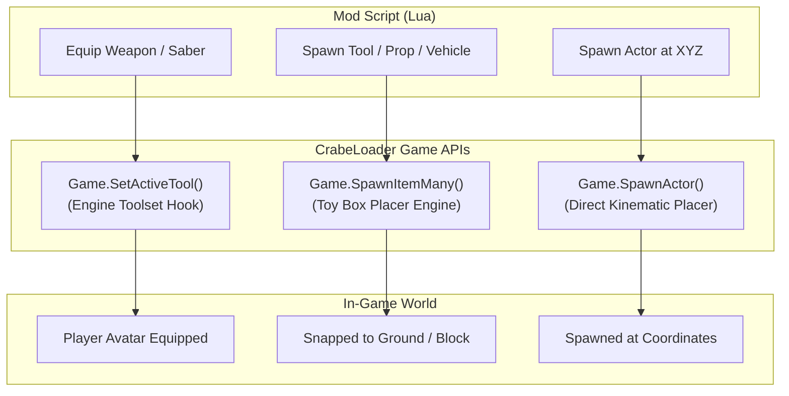

# Spawners, Weapons & Vehicle Invocations

A complete developer guide to spawning items, vehicles, world props, and equipping weapons (lightsabers, blasters, jetpacks) in **Disney Infinity 3.0** using **CrabeLoader's Spawner and Weapon APIs** (`Game.Spawn*` and `Game.SetActiveTool`).

---

## 1. Overview & Architecture

Disney Infinity 3.0 provides two distinct paths for placing entities into the world:
1. **Toy Box Placer Engine (`Game.SpawnItem*`)**: Emulates the player placing objects using the Toy Box wand/editor. It performs an automatic downward physics raycast, snaps objects flush to the terrain, and registers them in the Toy Box budget counter.
2. **Kinematic Actor Placement (`Game.SpawnActor`)**: Spawns an actor directly at specific XYZ coordinates, bypassing editor states.
3. **Engine Tool Manager (`Game.SetActiveTool`)**: Hands weapons, gadgets, or vehicles directly to the player avatar without needing a Toy Box wand.



---

## 2. Spawning Objects and Vehicles

### 2.1. Spawning via the Toy Box Placer
In the Toy Box or Toy Box Hub, use `Game.SpawnItem` or `Game.SpawnItemMany`:

```lua
-- Spawns 1 standard vehicle or prop in front of Player 1
Game.SpawnItem("Vehicle_Landspeeder")

-- Spawns multiple enemies or objects at once
local count = Game.SpawnItemMany("INV_NPC_TCW_BattleDroid_Blaster", 5)
print(string.format("Spawned %d battle droids!", count))

-- Spawns an item at specific world coordinates with terrain raycasting
Game.SpawnItemAt("Toy_CinderellaCoach", 25.0, 10.0, -15.0)
```

### 2.2. Spawning Vehicles Directly
To summon a driveable vehicle right next to the player:

```lua
Game.SpawnVehicle("Vehicle_GrievousWheelBike")
```

---

## 3. Equipping Weapons, Lightsabers & Gadgets

CrabeLoader hooks the engine's `_G.SetActiveTool` native to equip master weapons directly onto the active player avatar (`src/api/18_weapons.lua`).

### 3.1. Equipping a Weapon
```lua
-- Equip Darth Vader's Red Lightsaber onto Player 1
Game.SetActiveTool("Tools.Lightsaber_DarthVader_Prop")

-- Equip Han Solo's DL-44 Blaster
Game.SetActiveTool("Tools.HanSolo_Blaster")

-- Equip Boba Fett's Jetpack
Game.SetActiveTool("Packs.BobaFett_Jetpack")

-- Unequip current weapon/tool
Game.UnequipTool()
```

### 3.2. Master Weapons & Gadgets Catalog (`Game.WEAPON_CATALOG`)

CrabeLoader bundles pre-tested identifiers for the most iconic weapons:

#### Master Lightsabers:
| Identifier | Description | Combat Characteristics |
| :--- | :--- | :--- |
| `Tools.GreenLightsaber` | Standard Green Lightsaber | Balanced strikes, Jedi combos |
| `Tools.Lightsaber_DarthVader_Prop` | Darth Vader's Red Saber | Heavy crushing strikes, Force throws |
| `Tools.Lightsaber_DarthMaul_Prop` | Darth Maul's Double Saber | Rapid spinning dual-blade combos |
| `Tools.Lightsaber_KyloRen_Prop` | Kylo Ren's Crossguard Saber | Unstable burning plasma, heavy slams |
| `Tools.Lightsaber_Ahsoka_Shoto` | Ahsoka Tano Dual Shoto | High agility, acrobatic slices |
| `Tools.Lightsaber_Mace_Prop` | Mace Windu Purple Saber | Form VII Vaapad combat strikes |
| `Tools.Lightsaber_Yoda_Prop` | Yoda Short Green Saber | Fast aerial flips and leaps |
| `Tools.Lightsaber_Ezra_Prop` | Ezra Bridger Blaster/Saber | Hybrid melee blade + stun blaster |

#### Blaster Rifles:
| Identifier | Description |
| :--- | :--- |
| `Tools.HanSolo_Blaster` | Han Solo's DL-44 Heavy Blaster |
| `Tools.Chewbacca_Bowcaster` | Chewbacca's Explosive Bowcaster |
| `Tools.BobaFett_Blaster` | Boba Fett's EE-3 Carbine Rifle |
| `Tools.Stormtrooper_Blaster` | E-11 Imperial Blaster |
| `Tools.StarLord_Blaster` | Star-Lord's Element Quad Blasters |

#### Packs & Gadgets:
| Identifier | Description |
| :--- | :--- |
| `Packs.BobaFett_Jetpack` | Mandalorian Jetpack (Hover & Flight) |
| `Packs.HoverBoard` | Sci-Fi Hoverboard (Fast ground traversal) |
| `Tools.TronDisc` | Tron Identity Disc (Ricochet projectile) |
| `Tools.WebShooter` | Spider-Man Web Shooters |
| `Tools.CaptainAmerica_Shield` | Vibranium Shield (Throw & Guard) |
| `Tools.FryingPan` | Rapunzel's Frying Pan (Blunt melee strike) |

---

## 4. Querying the Inventory Catalog

To inspect available toys and tools in the current world context:

```lua
-- List all classic category items
local items = Game.ListInventory("MCAT_Classic")
for i, item in ipairs(items) do
    print(string.format("[%d] %s", i, item))
end
```
